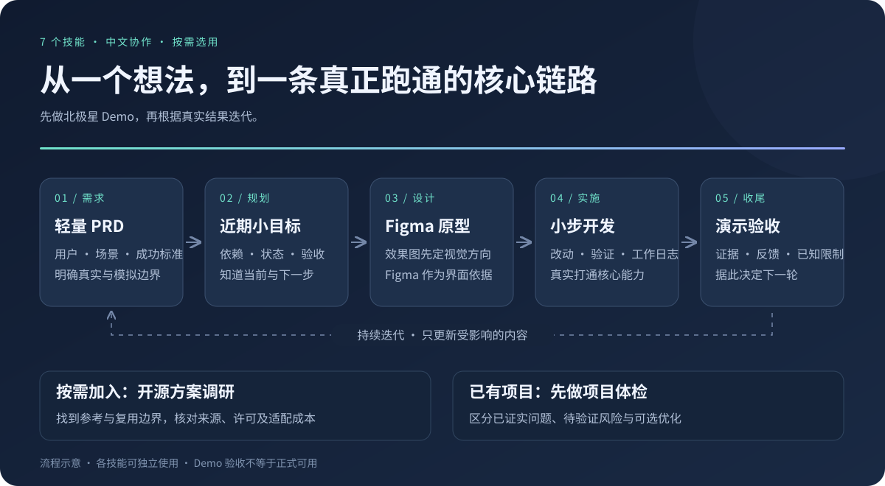
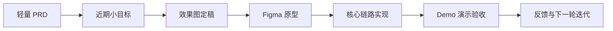

# 项目管理 Skills

<div align="center">
  
  <h3>和 AI 一起，把想法推进成能展示、能迭代的软件</h3>
  <p>7 个中文工作流入口，覆盖需求、选型、规划、设计、开发、体检与收尾。</p>
  <p><strong>先打通核心链路，再根据真实结果持续迭代。</strong></p>
  <p><a href="#从哪个入口开始">选择入口</a> · <a href="#安装与使用">安装与使用</a> · <a href="#七个技能怎么用">使用示例</a> · <a href="#模板与案例">模板与案例</a></p>
</div>

<p align="center">
  <a href="LICENSE"></a>
  <a href="#七个技能怎么用"></a>
  <a href="#先做一个北极星-demo"></a>
</p>

<p align="center">
  
</p>

---

一个想法刚起步，不知道先做什么；接手 AI 写过的项目，不清楚哪里可信；功能写完了，却不知道怎样验收、如何接续下一步——这组 Skills 为这些具体任务提供可复用的协作方式。

你可以只选一个入口解决当前问题，也可以在已授权范围内连续推进。需求、计划、设计和代码分别保留依据，换对话时能找到当前状态，修改后知道验证了什么、下一步做什么。

## 从哪个入口开始

| 你现在的情况 | 建议入口 | 会得到什么 |
| --- | --- | --- |
| 有产品想法，核心场景和首版范围还不清楚 | [产品需求](product-discovery-to-prd/SKILL.md) | 已确认范围、业务规则、验收与未决问题 |
| 想看看现有开源项目能借鉴哪些部分 | [开源选型](open-source-solution-research/SKILL.md) | 有来源的比较、复用条件、成本与风险 |
| 需求明确，需要知道现在先做哪一步 | [开发路线图](development-roadmap/SKILL.md) | 编号小目标、依赖、状态与当前／下一步 |
| 准备设计页面，或调整已有交互 | [UI 原型](ui-prototype-to-components/SKILL.md) | 效果图定稿、Figma 原型与组件交接 |
| 已有代码，想先找影响继续开发的问题 | [项目体检](existing-project-review/SKILL.md) | 有证据、按优先顺序整理的发现与补验建议 |
| 当前目标明确，可以开始实现或修复 | [小步开发](incremental-development/SKILL.md) | 实际改动、验证记录、提交建议与下一步 |
| Demo 或版本准备收尾，需要核对完成情况 | [验收收尾](release-readiness/SKILL.md) | 验收结论、限制与交接；有发布安排时提供 Release 草稿 |

## 先做一个北极星 Demo

北极星 Demo 用一条完整流程展示软件最核心的价值。用户明确选择这个目标时，先回答五件事：**给谁用、展示哪条链路、怎样算成功、哪些暂缓、哪些真实或模拟。** 这些内容可以组成简短、已确认的 PRD，无需先写完整产品规划。



例如文章摘要工具，可以先验证“粘贴文章 → 真实模型分析 → 展示摘要”，账号、历史记录和同步暂缓。外围能力允许按约定模拟，但核心模型不能用固定摘要代替后声称已经验证。

路线图只细化近期步骤，模板按需使用；已确认内容继续沿用，不为环节切换重复审批。后续局部迭代只更新受影响的需求、设计和代码。Demo 演示通过后，仍需区分技术链路能运行与用户认为结果有价值。

## 安装与使用

本仓库目前提供独立技能文件夹，采用手动复制方式安装。以个人 Codex Skills 目录为例，将需要的**整个文件夹**放到 `~/.codex/skills/`，保留模板、案例和入口配置；已有同名技能时先比较内容，避免覆盖自己的修改。

```text
~/.codex/skills/
└── product-discovery-to-prd/
    ├── SKILL.md
    ├── agents/openai.yaml
    ├── assets/PRD.md
    └── references/discovery-example.md
```

新建会话后，可通过 `$技能名` 明确调用：

```text
使用 $product-discovery-to-prd，帮我梳理一个文章摘要工具。
先做北极星 Demo，只验证一条核心链路，PRD 先在对话里展示。
```

技能定义协作方法，实际执行依赖当前环境提供的工具。生成效果图需要图像生成能力，Figma 原型需要相应工具及文件访问权限，代码运行和真实服务调用也需要对应环境。

## 七个技能怎么用

### 1. 产品需求：先明确这一轮要解决什么

[`$product-discovery-to-prd`](product-discovery-to-prd/SKILL.md) 从场景和现有材料出发，区分用户决定、助手建议与待验证假设，再收敛范围和验收。支持轻量 Demo PRD，也支持后续需求修订；已有确认不重复询问。

```text
使用 $product-discovery-to-prd，根据这些笔记整理当前 Demo 的轻量 PRD。
明确用户、核心流程、成功标准、暂缓项和模拟边界。
只问会影响当前链路的关键问题，先在对话中给我审阅。
```

### 2. 开源选型：找到能借鉴的部分，也算清适配成本

[`$open-source-solution-research`](open-source-solution-research/SKILL.md) 核查候选项目的来源、维护情况、许可证、技术栈与部署门槛，说明适合参考哪些思路、复用哪些模块，以及需要验证什么。完整选型交付报告，推荐不自动变成采用决定。

```text
使用 $open-source-solution-research，为当前项目比较可自部署的全文检索方案。
重点看中文支持、许可证、运行门槛和适配成本，附原始来源。
先做选型调研，不安装或集成。
```

### 3. 开发路线图：把目标变成当前可推进的一步

[`$development-roadmap`](development-roadmap/SKILL.md) 将已确认范围拆成有依赖、有验收的小目标。Demo 只细化核心链路；需求变化时保留旧步骤的去向，不把代码已写误记为验收完成。

```text
使用 $development-roadmap，根据已确认的轻量 PRD 安排这个 Demo。
只细化核心链路的近期步骤，列出依赖、验收和当前／下一步。
外围能力暂缓，不提前拆完整产品计划。
```

### 4. UI 原型：效果图定方向，Figma 交付开发依据

[`$ui-prototype-to-components`](ui-prototype-to-components/SKILL.md) 按需搜集视觉参考，先生成代表页面效果图并定稿，再在 Figma 落实可编辑结构、组件与关键状态，交接到对应页面或节点。

| 产物 | 用途 |
| --- | --- |
| 效果图 | 视觉定稿与 Figma 制作参考 |
| Figma 原型 | 界面开发及状态核对的依据 |
| PRD | 业务规则与行为验收的依据 |

HTML 只在 Figma 无法调用、恢复尝试无效后作为兜底方案讨论。局部变化沿用已有方向，更新相关 Figma 内容；开发框架按实际项目决定。

```text
使用 $ui-prototype-to-components，设计已确认 PRD 中的文章摘要链路。
先用一个代表页面的效果图定稿，再制作 Figma 原型。
只覆盖当前必需页面与状态，交接 Figma 入口、组件和验收条件。
```

### 5. 项目体检：让结论有证据，让修复有边界

[`$existing-project-review`](existing-project-review/SKILL.md) 优先检查用户关心的核心流程，把发现分为已证实问题、待验证风险和可选优化。每项附位置、触发条件、证据及最小修复或补验方法，避免把体检扩成全面重构。

```text
使用 $existing-project-review，检查当前项目的任务保存和搜索链路。
区分已证实问题、待验证风险和可选优化，给出处理顺序。
这一轮只体检，不修改代码。
```

### 6. 小步开发：做出改动，也留下验证结果

[`$incremental-development`](incremental-development/SKILL.md) 接手一个明确目标，核对 Git 和相关代码后实施、检查 diff 并验证。界面依据 Figma，业务依据 PRD；日志可用简短条目，每次修改后提供提交信息、实际状态和下一步。

```text
使用 $incremental-development，完成路线图当前的摘要调用步骤。
沿用已确认 PRD 和 Figma，真实接通模型，不扩展账号与历史记录。
先简要说明 Git 状态、改动范围和验收方法，然后按已有授权实施。
```

### 7. 验收收尾：分清能演示、已验证和可正式使用

[`$release-readiness`](release-readiness/SKILL.md) 汇总当前范围的实际证据，找出失败、缺口、顺延和限制。本地 Demo 使用简短演示验收，有发布安排时再准备 Release 草稿与发布来源核对。

```text
使用 $release-readiness，核对这个本地 Demo 是否达到约定演示条件。
检查真实核心链路、关键失败处理、模拟边界及必需的用户反馈。
引用已有日志，不准备发布材料；给出结论与下一小目标。
```

## 模板与案例

模板用于具体项目，按需选用；已有格式就继续使用。案例用于理解记录与交接方式，其中的虚构对话、确认和结果不能作为真实项目证据。

| 环节 | 可复制模板 | 参考案例 |
| --- | --- | --- |
| 产品需求 | [PRD](product-discovery-to-prd/assets/PRD.md) | [需求收敛与 Demo 试填](product-discovery-to-prd/references/discovery-example.md) |
| 开发规划 | [路线图](development-roadmap/assets/ROADMAP.md) | [需求变更与短版计划](development-roadmap/references/change-example.md) |
| 界面设计 | [设计交接](ui-prototype-to-components/assets/DESIGN-HANDOFF.md) | [Demo 设计交接](ui-prototype-to-components/references/demo-example.md) |
| 项目体检 | [体检记录](existing-project-review/assets/REVIEW.md) | [体检报告](existing-project-review/references/review-example.md) |
| 代码实施 | [工作日志](incremental-development/assets/WORKLOG.md) | [小修复](incremental-development/references/fix-example.md) · [Demo 实施](incremental-development/references/demo-example.md) |
| 验收收尾 | [验收记录](release-readiness/assets/ACCEPTANCE.md) | [版本与 Demo 收尾](release-readiness/references/closeout-example.md) |
| 跨会话接续 | [通用交接](templates/HANDOFF.md) | 引用项目已有需求、路线图与日志 |

开源选型目前由技能正文提供报告要求，尚无独立配套模板与案例。

## 验证与当前进展

仓库包含技能说明、入口配置、模板、案例及少量评测夹具。已有材料包括：

- [轻量评测方法](evaluation/README.md)与[案例记录模板](evaluation/CASE.md)：用于比较具体任务结果。
- [小步开发受控试跑](evaluation/incremental-development-smoke.md)：记录函数修复前后的实际离线检查。
- [Demo 流程串联检查](evaluation/demo-workflow-review.md)：记录五个技能的文档衔接与边界核对。

格式检查、文档推演和函数测试各有覆盖范围。目前尚未完成真实项目中的 Image → Figma → 开发 → 演示整条流程验证，也未证明准备耗时已经降低。后续根据真实使用中的重复询问、交接缺口和验收结果继续调整。

## 文件结构

```text
项目管理skills/
├── product-discovery-to-prd/       # 产品需求
├── open-source-solution-research/ # 开源选型
├── development-roadmap/           # 开发路线图
├── ui-prototype-to-components/    # 效果图、Figma 与设计交接
├── existing-project-review/       # 项目体检
├── incremental-development/       # 小步实施与日志
├── release-readiness/             # 验收收尾
├── templates/HANDOFF.md           # 通用交接模板
├── evaluation/                    # 评测方法、记录与夹具
├── LICENSE
└── README.md
```

每个技能都有 `SKILL.md` 与 `agents/openai.yaml`；有配套资源的技能另含 `assets/` 和 `references/`。独立安装时复制整个技能文件夹，根目录的通用交接和评测材料按需另外取用。

## 修改与反馈

改进技能时，优先提供触发问题的请求、预期行为与实际结果；隐去密钥、个人资料和私有项目内容。每次围绕一个具体问题做局部调整，检查相关引用与 diff，需要时补充案例或行为验证。

本仓库采用 [MIT License](LICENSE)，允许使用、修改与再分发，包括商业用途；须保留版权声明和许可证文本。
